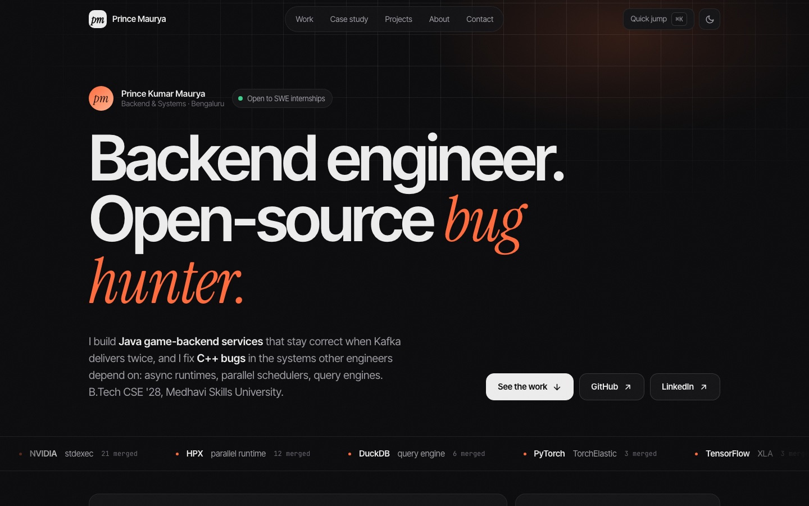
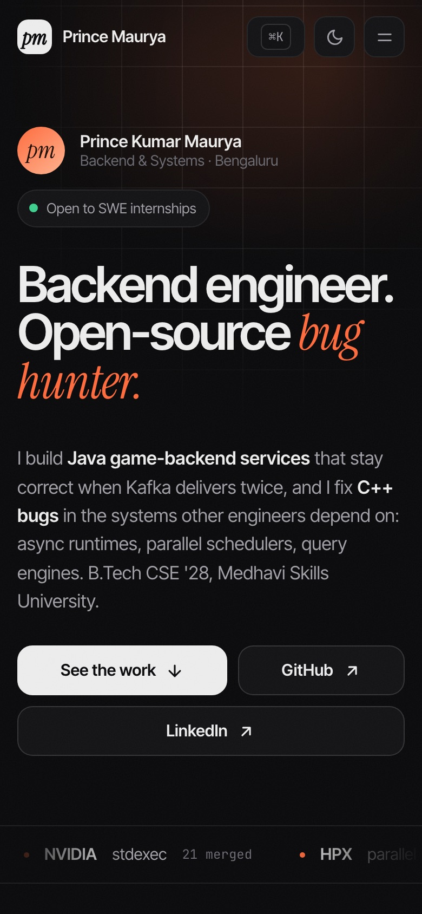

<div align="center">

# Prince Kumar Maurya · Portfolio

**Backend engineer. Open-source bug hunter.**

### 🔗 [alwaysprince05.github.io](https://alwaysprince05.github.io/)

[](https://alwaysprince05.github.io/)
[](https://github.com/alwaysprince05/alwaysprince05.github.io/actions/workflows/deploy.yml)


<br>

<a href="https://alwaysprince05.github.io/">
  <picture>
    <source media="(prefers-color-scheme: light)" srcset="docs/preview-light.jpg">
    
  </picture>
</a>

</div>

---

## About

My personal site: Java game-backend services and **51 merged pull requests** across NVIDIA stdexec, HPX,
DuckDB, ClickHouse, PyTorch and TensorFlow, each linked to the real PR.

## What's on the site

| Section | What it shows |
| --- | --- |
| **Hero + activity** | GitHub contribution heatmap, merged-PR stats, a terminal replay of recent merges, PRs in review, local time |
| **Open source** | All 51 merged PRs, filterable by repository and searchable by keyword |
| **Case study** | A step-by-step walkthrough of a real DuckDB fix ([#25232](https://github.com/duckdb/duckdb/pull/25232)) |
| **Projects** | [Game Leaderboard Service](https://github.com/alwaysprince05/game-leaderboard-service) (Kafka, Postgres, Redis) and more |
| **About + contact** | Experience, skills, and one-click email copy |

**Nice touches:** <kbd>⌘</kbd> <kbd>K</kbd> quick-jump menu · <kbd>/</kbd> to search PRs · light / dark theme ·
fully responsive · respects reduced-motion settings.

<details>
<summary><b>📱 Mobile view</b></summary>
<br>
<div align="center">
  
</div>
</details>

## Run it locally

```bash
git clone https://github.com/alwaysprince05/alwaysprince05.github.io.git
cd alwaysprince05.github.io
npm install
npm run dev       # http://localhost:5173
```

| Command | Does |
| --- | --- |
| `npm run dev` | Start the dev server with hot reload |
| `npm run build` | Type-check and build into `dist/` |
| `npm run preview` | Serve the production build locally |

## Project structure

```
src/
├── data.ts                  merged / open PRs and the contribution calendar
├── lib.ts                   links, theme toggle, shared hooks
├── styles.css               design tokens and styles (dark + light)
└── components/
    ├── Nav.tsx              sticky nav, scroll progress, mobile menu
    ├── Bento.tsx            heatmap, stats, terminal, in-review, clock tiles
    ├── Sections.tsx         hero, work, case study, projects, about, contact
    └── CommandPalette.tsx   ⌘K menu
```

To refresh the numbers, update `src/data.ts`. The PR counts on the page are calculated from it.

## Deployment

Every push to `main` runs [`deploy.yml`](.github/workflows/deploy.yml): it builds the site and publishes
`dist/` to GitHub Pages at **[alwaysprince05.github.io](https://alwaysprince05.github.io/)**.

---

<div align="center">

**[Live site](https://alwaysprince05.github.io/)** ·
**[GitHub](https://github.com/alwaysprince05)** ·
**[LinkedIn](https://www.linkedin.com/in/prince-kumar-maurya-67a41128b/)** ·
**[LeetCode](https://leetcode.com/u/alwaysprince05/)**

</div>
